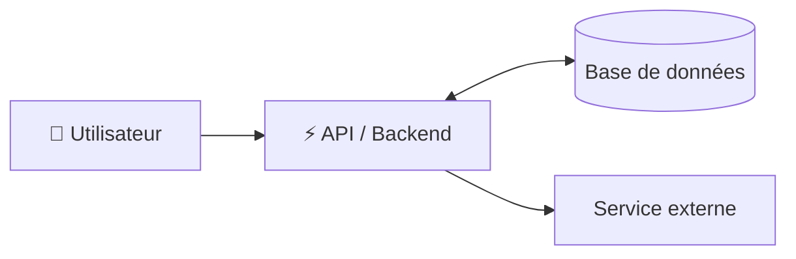

<!--
  TEMPLATE README : copier à la racine du projet sous le nom README.md.
  Remplacer chaque [À COMPLÉTER : ...] et supprimer les commentaires et
  les sections marquées (optionnel) si elles ne s'appliquent pas.-->

<div align="center">

# 🚀 [À COMPLÉTER : Nom du projet]

**[À COMPLÉTER : 1 à 2 phrases : le problème résolu, pour qui, et ce qui différencie le projet.]**

[](https://github.com/<user>/<repo>/actions/workflows/ci.yml)
[](LICENSE)
[](https://github.com/<user>/<repo>/releases)
[](https://github.com/<user>/<repo>/issues)
<!-- Un badge par techno majeure, ex. :
[](https://www.python.org) -->

</div>

---

## 📖 Sommaire

- [Aperçu](#-aperçu)
- [Fonctionnalités](#-fonctionnalités)
- [Architecture](#️-architecture)
- [Démarrage rapide](#-démarrage-rapide)
- [Utilisation](#️-utilisation)
- [API](#-api) *(optionnel)*
- [Configuration](#️-configuration)
- [Tests et qualité](#-tests-et-qualité)
- [Structure du projet](#-structure-du-projet)
- [Roadmap](#️-roadmap)
- [Contribution](#-contribution)
- [Projet lié](#-projet-lié) *(optionnel)*
- [Auteur et licence](#-auteur-et-licence)

---

## 🧐 Aperçu

[À COMPLÉTER : le « pourquoi » en 3 à 5 lignes : contexte, problème, public visé, résultat concret pour l'utilisateur. Donner 1 ou 2 exemples réels d'usage.]


*[À COMPLÉTER : légende de la démo : ce que l'on voit, avec quelles données, comment la régénérer.]*

> [!NOTE]
> [À COMPLÉTER : limites connues, choix de conception ou compatibilités importantes.]

---

## ✨ Fonctionnalités

- **🚀 [À COMPLÉTER : Fonctionnalité 1]** : [bénéfice concret, chiffré si possible].
- **🔐 [À COMPLÉTER : Fonctionnalité 2]** : [...].
- **🔌 [À COMPLÉTER : Fonctionnalité 3]** : [...].
- **🧪 Qualité** : [À COMPLÉTER : nombre de tests, lint, CI, évaluation].

---

## 🏗️ Architecture



| Service / Composant | Technologie | Rôle | Port |
| ------------------- | ----------- | ---- | ---- |
| `[À COMPLÉTER]`     | [techno]    | [rôle] | `[port]` |

👉 Détails et justification des choix : [`docs/architecture.md`](docs/architecture.md)

---

## 🚀 Démarrage rapide

### Prérequis

- [À COMPLÉTER : outil + version minimale (ex. Docker Compose v2.20+, Python 3.11, Node 20)]
- **Option A, [variante 1]** : [prérequis spécifiques]
- **Option B, [variante 2]** : [prérequis spécifiques]

### Installation

```bash
git clone https://github.com/<user>/<repo>.git
cd <repo>
cp .env.example .env      # puis renseignez les variables obligatoires
```

### Lancement

```bash
make up                   # [À COMPLÉTER : ou la commande équivalente]
```

| Interface / Service | URL |
| ------------------- | --- |
| [À COMPLÉTER]       | [http://localhost:PORT](http://localhost:PORT) |
| Documentation API   | [http://localhost:PORT/docs](http://localhost:PORT/docs) |

> [!IMPORTANT]
> [À COMPLÉTER : étape obligatoire ou téléchargement long au premier démarrage (taille, durée).]

**✅ Vérifier que tout fonctionne** : [À COMPLÉTER : un test simple, avec la commande ou l'action et le résultat attendu.]

---

## 🛠️ Utilisation

### Exemples de base

```bash
# [À COMPLÉTER : commande de base]
./bin/exécutable --option valeur
```

### Scénarios courants

- [À COMPLÉTER : scénario 1] : `commande`
- [À COMPLÉTER : scénario 2] : `commande`
- Lancer les tests : `make test`

### Paramètres disponibles

| Argument        | Description              | Défaut   |
| --------------- | ------------------------ | -------- |
| `-p, --port`    | Port d'écoute            | `8080`   |
| `-v, --verbose` | Active le mode debug     | `false`  |

---

## 🔌 API

*(optionnel : supprimer si le projet n'expose pas d'API)*

Toutes les routes (sauf `[/health]`) exigent [À COMPLÉTER : en-tête ou mécanisme d'authentification].

| Méthode | Route     | Rôles  | Description |
| ------- | --------- | ------ | ----------- |
| `GET`   | `/health` | public | État du service |
| `POST`  | `[/route]`| [rôle] | [description] |

```bash
curl -X POST http://localhost:8080/[route] \
  -H "X-API-Key: $API_KEY" -H "Content-Type: application/json" \
  -d '{"champ": "valeur"}'
```

```json
{
  "résultat": "[À COMPLÉTER : exemple de réponse]"
}
```

*(exemple illustratif : les valeurs exactes dépendent de la configuration)*

---

## ⚙️ Configuration

Toutes les options sont dans [`.env.example`](.env.example). Les principales :

| Variable | Défaut | Description |
| -------- | ------ | ----------- |
| `[VARIABLE_1]` | `[valeur]` | [description] |
| `[VARIABLE_2]` | `—`        | [description, obligatoire] |

> [!WARNING]
> Ne commitez jamais de clés ou secrets : utilisez `.env` (ignoré par Git) ou un gestionnaire de secrets.

---

## 🧪 Tests et qualité

```bash
make test                 # [À COMPLÉTER : nombre de tests et périmètre]
make lint                 # [À COMPLÉTER : outils de lint / format]
```

[À COMPLÉTER : ce que les tests garantissent (ex. propriété de sécurité critique), exécution en CI, évaluation de la qualité si pertinent.]

---

## 📁 Structure du projet

```text
.
├── src/              # [À COMPLÉTER : code source principal]
├── tests/            # [tests automatisés]
├── docs/             # [documentation complémentaire, architecture.md]
├── examples/         # [données ou exemples d'usage]
├── .github/
│   └── workflows/    # [CI : ci.yml]
├── .env.example      # [variables d'environnement documentées]
├── .gitignore
├── LICENSE
└── README.md
```

---

## 🗺️ Roadmap

- [ ] [À COMPLÉTER : amélioration 1]
- [ ] [À COMPLÉTER : amélioration 2]
- [ ] [À COMPLÉTER : amélioration 3]

---

## 🤝 Contribution

Les contributions sont les bienvenues.

1. **Forkez** le projet.
2. Créez votre branche (`git checkout -b feature/ma-fonctionnalite`).
3. **Committez** vos changements (`git commit -m "feat: ma fonctionnalité"`).
4. **Poussez** la branche (`git push origin feature/ma-fonctionnalite`).
5. Ouvrez une **Pull Request**.

Voir [`CONTRIBUTING.md`](CONTRIBUTING.md) pour les conventions et la checklist de validation.

---

## 🔗 Projet lié

*(optionnel)*

[À COMPLÉTER : lien vers un projet parent ou précurseur, ce qui est repris, ce qui est nouveau, et les co-auteurs éventuels.]

---

## 👤 Auteur et licence

**[À COMPLÉTER : Prénom Nom]** · [GitHub](https://github.com/<user>)

Distribué sous licence **[À COMPLÉTER : MIT]**. Voir le fichier [`LICENSE`](LICENSE).
